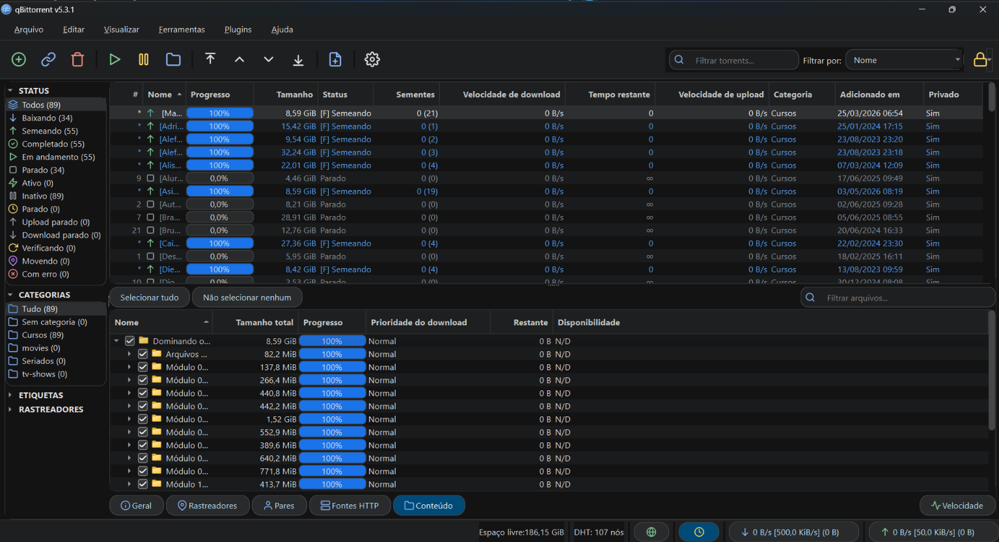
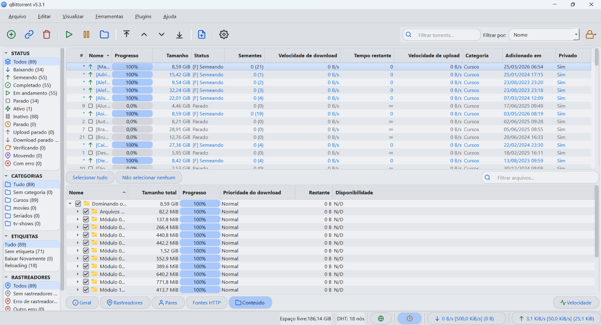
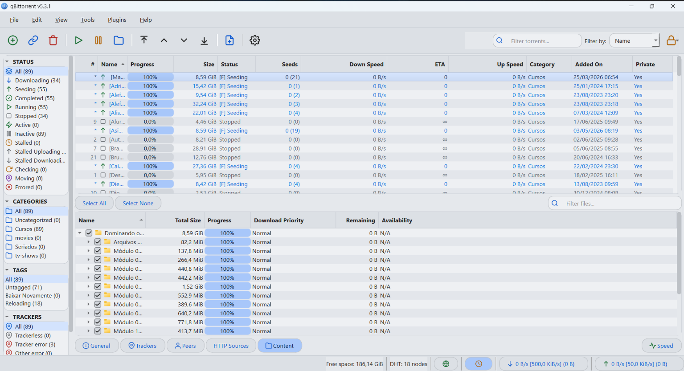

### 📸 Screenshots / Capturas de Tela

#### 🇧🇷 Versão em Português (PT-BR)

| Google Material Dark | Google Material Light (High Contrast) |
| :---: | :---: |
|  |  |

<b>Ver também: Google Material Light (Soft Edition - PT-BR)</b>

 

  

 

<b>🇺🇸 Click to view English Screenshots (EN-US)</b>

 

| Google Material Dark | Google Material Light (High Contrast) |
| :---: | :---: |
|  |  |

  <b>Google Material Light (Soft Edition)</b>  
  

