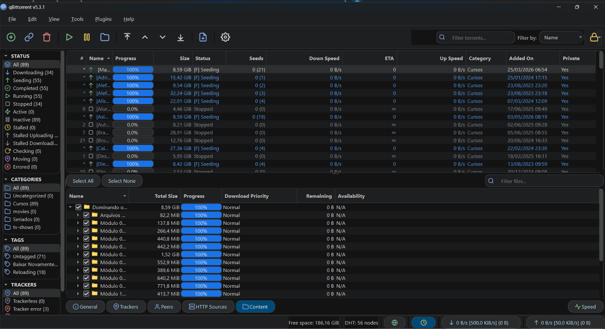
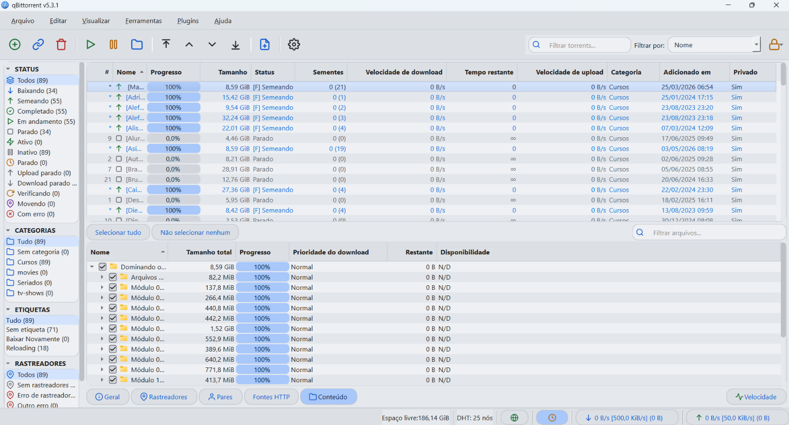

# Google Material You Themes — Dark & Light Pack for qBittorrent (v5.x+)

Uma coleção moderna e minimalista de temas para o **qBittorrent**, inspirada na linguagem visual **Google Material You**. Projetada com foco em conforto visual, alto contraste e consistência, contando com **85 ícones vetoriais (`.svg`)** redesenhados, barras de progresso nítidas e **caixas de seleção padronizadas** em toda a interface.

*(English version & screenshots below)*

---

### 📸 Screenshots / Capturas de Tela

#### 🇧🇷 Versão em Português (PT-BR)

| Google Material Dark | Google Material Light (High Contrast) |
| :---: | :---: |
|  |  |

<b>Ver também: Google Material Light (Soft Edition - PT-BR)</b>

 

  

 

<b>🇺🇸 Click to view English Screenshots (EN-US)</b>

 

| Google Material Dark | Google Material Light (High Contrast) |
| :---: | :---: |
|  |  |

  <b>Google Material Light (Soft Edition)</b>  
  

---

### 🎨 Edições Disponíveis / Available Editions

* **`Google_Material_Dark.qbtheme`** — Modo Escuro com fundos em cinza-ardósia profundo (`#131314`), barras de progresso azul Google (`#1A73E8`) de alto contraste e seleção de linhas em grafite (`#2D2F31`).
* **`Google_Material_Light.qbtheme`** — Modo Claro Suave em branco acinzentado fosco (`#E5E8EC`) para evitar brilho excessivo, com textos pastéis discretos.
* **`Google_Material_Light_HighContrast.qbtheme`** — Modo Claro Alto Contraste com a mesma base fosca confortável, mas com textos escuros saturados (`#0B57D0`, `#146C2E`) para leitura máxima.

---

<b>🇧🇷 Guia Completo de Instalação e Recursos (Português)</b>

 

#### ✨ Principais Recursos
* **85 Ícones Vetoriais Customizados (`.svg`):** Cobertura total de menus, barras de ferramentas, filtros laterais, abas de configurações e bandeja do sistema no estilo Material Design.
* **Controles e Caixas de Seleção Padronizados:** Caixas de seleção (*checkboxes*), botões circulares (*radio buttons*), menus e árvores de arquivos na aba *Conteúdo* estilizados com bordas discretas e sinal de seleção nítido.
* **Interface Arredondada:** Menus suspensos, abas, botões e campos de filtro com cantos suaves.

#### 📥 Como Instalar e Aplicar
1. Baixe a edição desejada (`.qbtheme`) neste repositório ou na aba **Releases** e salve-a em uma pasta de sua preferência.
2. Abra o **qBittorrent** e vá em **Ferramentas > Opções > Comportamento**.
3. Na seção *Interface*, ajuste a opção **Esquema de cor** para corresponder ao tema escolhido:
   * Selecione **`Escuro`** ao usar o tema *Dark*.
   * Selecione **`Claro`** ao usar qualquer uma das versões *Light* (isso garante o carregamento correto das cores claras, mesmo se o Windows estiver no modo escuro).
4. Marque **`Usar tema personalizado da interface do usuário`**, clique no ícone de pasta ao lado de *Arquivo de tema* e selecione o arquivo `.qbtheme` baixado.
5. *(Recomendado ao trocar de tema)* Clique em **Personalizar tema da interface... > Redefinir > OK** para limpar caches antigos de cores.
6. Clique em **Aplicar > OK** e **reinicie o qBittorrent** (feche-o completamente pela bandeja do sistema).

 

<b>🇺🇸 Full Installation Guide & Features (English)</b>

 

#### ✨ Key Features
* **Complete Vector Icon Set (85 SVGs):** Custom Material-style icons covering menus, toolbars, sidebar filters, settings tabs, and system tray.
* **Unified Checkboxes & Controls:** Consistent, clearly visible indicators for checkboxes, radio buttons, context menus, and file trees under the *Content* tab.
* **Modern Rounded UI:** Smooth Material Design corners on buttons, tabs, dropdown menus, and input fields.

#### 📥 Installation
1. Download your preferred `.qbtheme` edition from this repository or the **Releases** page and save it to a folder of your choice.
2. Open **qBittorrent** and navigate to **Tools > Options > Behavior**.
3. Under the *Interface* section, set **Color scheme** to match your chosen theme:
   * Select **`Dark`** when using the *Dark* theme.
   * Select **`Light`** when using either *Light* edition (this ensures light text colors load properly even if Windows is set to Dark Mode).
4. Check **`Use custom UI theme`**, click the folder icon next to *UI theme file*, and select the downloaded `.qbtheme` file.
5. *(Recommended when switching themes)* Click **Customize UI theme... > Reset > OK** to clear any cached colors.
6. Click **Apply > OK**, and **restart qBittorrent** (fully close it from the system tray) to load all icons and styles.

#### 🛠️ Compatibility
* Tested and optimized for **qBittorrent v5.0 and above** (including v5.3.1+).

